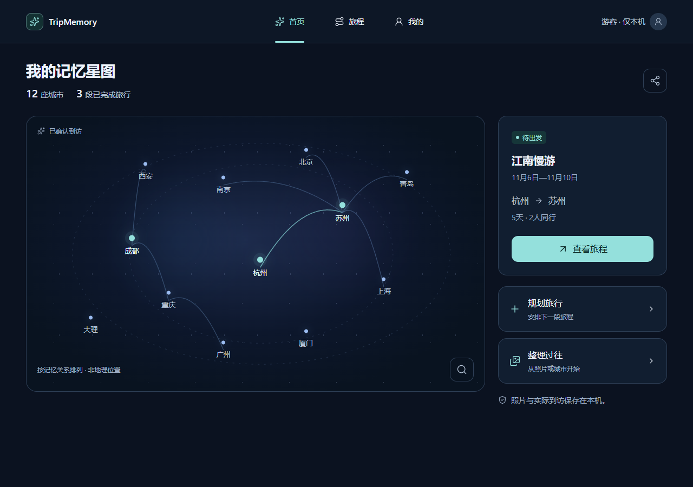
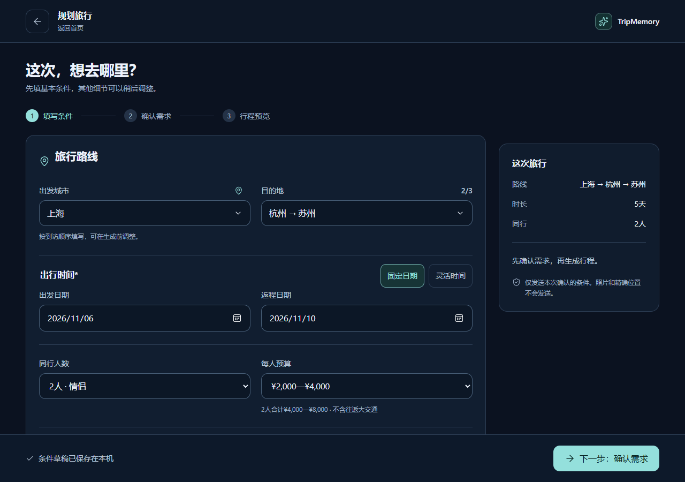
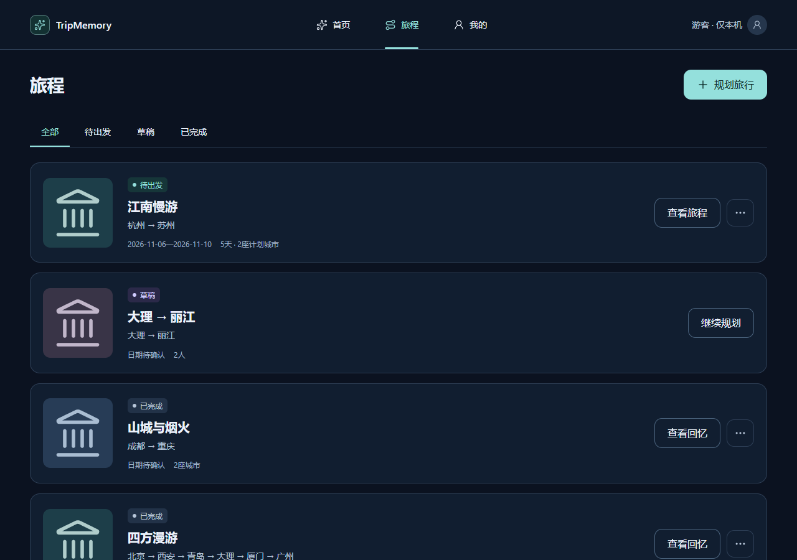
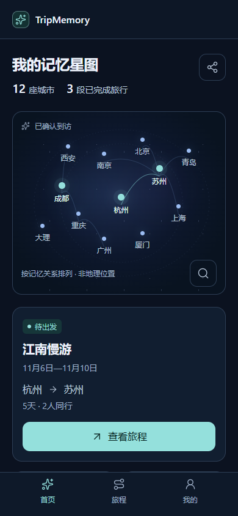

# TripMemory

让每一段旅行，从计划变成自己的回忆。

TripMemory 是一款本机优先的旅行规划与记忆管理 Web/PWA。它将出发前的计划、旅行中的每日安排与地点记录、旅行后的照片和回忆放进同一段旅程，让“准备怎么走”和“实际去过哪里”彼此衔接，但不混为一谈。

本仓库 `TripMemory_Case` 用于公开产品介绍、UI 展示和少量通用前端源码。**它不是完整产品源码，也不是可直接部署的应用。** 完整实现及内部产品文档不在公开范围内。

## 产品介绍

旅行前，用户希望把零散想法变成可阅读、可调整的安排；旅行中，需要按天查看计划，并留下真实记录；旅行后，则希望能从旅程和城市重新找到照片与回忆。

TripMemory 围绕同一段旅程组织这三个阶段：

- **出发前**：填写旅行条件，确认需求，生成并调整计划，再明确保存到旅程。
- **旅行中**：按日查看安排，记录活动结果、地点与实际到访，添加照片。
- **旅行后**：核对实际经历，整理照片，从旅程或城市回看旅行回忆。

产品保留“首页 / 旅程 / 我的”三个一级入口。首页的城市星点呈现个人旅行记忆；星点与连线表达确认后的到访及旅行关系，不是地理导航地图。

## MVP 版本

当前产品处于持续迭代的 Web/PWA MVP 阶段。最小价值闭环是：

**填写条件 → 确认需求 → 生成与调整计划 → 保存旅程 → 每日记录 → 核对实际经历 → 回看照片与回忆。**

| 模块 | MVP 中的产品能力 |
| --- | --- |
| 旅行规划 | 结构化条件、需求确认、AI 计划、流式展示与明确保存 |
| 旅程管理 | 草稿、待出发与已完成旅程；旅行命名与详情查看 |
| 每日记录 | 按日浏览原计划，分别记录活动结果、地点与实际经历 |
| 照片与回忆 | 添加本机照片，明确照片归属，从旅程和城市回看 |
| 记忆星图 | 根据用户确认的实际到访沉淀城市记忆 |

产品原则是：**计划不等于实际经历，照片也不自动代表确认到访。** 没有记录的结果不补造成“已完成”；没有可靠来源的信息不冒充已核实事实。

游客入口和本机使用保留。账号、云同步和真实 AI 服务依赖实际部署与配置；本仓库不提供可登录账号、公共 AI 调用服务或在线体验承诺。天气服务尚未接入时如实提示不可用；现实中的商户、地址、开放时间与交通信息仍需核实。

## 产品 UI 展示

以下 5 张图片来自项目既有 R1 组件视觉验证阶段，使用生产 UI 组件和合成示例数据渲染，并非设计稿，也不包含真实用户账号、个人照片或真实出行记录。

这些是**阶段性界面展示**：部分交互使用静态回调，不证明 AI、登录、同步、持久化或整站功能已在线验收；后续实现可能有所变化。截图中的城市、日期、预算和数量均为示例，不是旅游事实或服务承诺。

### 首页：个人旅行记忆星图

从城市记忆回看过往旅行，同时保留“规划旅行”和“整理过往”的入口。

### 规划旅行：先填写条件，再确认需求

将路线、日期、同行人数和预算放在同一流程中，生成前先让用户确认需求。

### 旅程：区分草稿、待出发与已完成

让不同阶段的旅程具有清楚的状态和下一步入口。

### 移动端：首页与旅程详情

保留移动端主导航，并以每日行程组织旅行详情。

  
  

## 本次公开的源码

本仓库只公开以下 3 个真实项目中的通用 UI 文件：

| 文件 | 展示内容 |
| --- | --- |
| [HelpTip.tsx](src/ui/HelpTip.tsx) | 帮助提示组件：鼠标悬停、触摸、键盘焦点与 Escape 关闭 |
| [help-tip.css](src/ui/help-tip.css) | 帮助提示组件的基础样式 |
| [modal-focus.ts](src/ui/modal-focus.ts) | 弹窗焦点管理：初始焦点、Tab 循环、背景隔离与关闭后焦点恢复 |

这些是 React + TypeScript 源码摘录，依赖宿主应用的运行环境、页面结构与样式。仓库没有完整应用入口、依赖清单和构建配置，不能通过克隆本仓库直接启动完整 TripMemory。

本次公开不包含核心业务、AI 提示词与编排、账号与同步、照片及位置处理、后端、数据库、部署配置、内部需求与设计文档、测试证据或原项目 Git 历史。UI 截图不代表其对应完整页面源码也已公开。

## 隐私与公开边界

- 产品以本机保存照片、EXIF 和精确位置为默认原则，不把添加照片等同于上传照片。
- 本仓库不包含用户照片、真实账号、密钥、环境变量、服务地址或个人出行数据。
- 后续公开更新继续采用逐文件清单审核，不自动同步完整开发仓库。
- 本次未添加开源许可证；许可证与使用授权不在本次发布中另行变更。

---

本仓库用于产品案例展示与有限源码展示。介绍更新于 2026-10-25；不等同于完整开源、正式生产发布或全功能验收结论。
